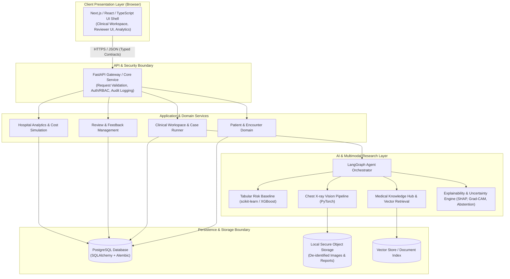

# Arogya AI — System Architecture Specification

> **Status Notice:** Foundation & Architecture Phase (Module 1).<br/>
> The architectural patterns, trust boundaries, and workflows described herein represent the **target architecture** for Arogya AI. **No application services, models, or data stores are active or implemented at this stage.**

---

## 1. System Boundaries & Core Components

Arogya AI is architected as a **modular monorepo** to maximize developer ergonomics, end-to-end type safety, and governance oversight without the operational overhead of fragmented microservices.



### Component Boundaries (Planned vs. Implemented)

| Component | Target Technology | Target Responsibility | Current Status |
| :--- | :--- | :--- | :--- |
| **Frontend UI** | Next.js 15, React 19, TypeScript | Clinical intake, evidence-linked result panels, explainability viewers, reviewer forms, and accessibility. | **Planned (Module 4)** |
| **Backend API** | Python 3.11+, FastAPI, Pydantic v2 | API contracts, identity/RBAC, input validation, service orchestration, structured error envelopes. | **Planned (Module 2)** |
| **Persistence** | PostgreSQL, SQLAlchemy 2.0, Alembic | Relational storage for users, synthetic patients, encounters, analysis runs, reviewer edits, and audit logs. | **Planned (Module 3)** |
| **Tabular ML** | Python, scikit-learn, XGBoost | Baseline classification models on structured vitals/labs with calibration and feature tracking. | **Planned (Module 9)** |
| **Vision ML** | Python, PyTorch, Torchvision | Chest X-ray analysis pipeline with preprocessing, inference service, and Grad-CAM generation. | **Planned (Module 10)** |
| **AI Orchestrator** | LangGraph, Pydantic | Deterministic state machine coordinating specialized research agents (summarizer, lab interpreter, imaging adapter). | **Planned (Module 11)** |
| **Knowledge Hub & RAG** | Vector Index, Embedding model | Ingestion, chunking, and source-attributed retrieval of curated medical guidelines and public literature. | **Planned (Module 12)** |
| **Explainability & Safety** | SHAP, Grad-CAM, Rule Critic | Feature attribution, visual heatmaps, contradiction detection, uncertainty estimation, and abstention triggers. | **Planned (Modules 13–14)** |
| **Deployment** | Docker, Docker Compose | Containerized local and demonstration environments with pinned dependencies and health checks. | **Planned (Module 20)** |

---

## 2. Proposed Target Request Flow

When fully implemented, case analysis within Arogya AI will follow a disciplined, audited request pipeline:

```text
1. Case Intake (Browser)
   └── Clinician or researcher submits synthetic symptoms, vitals, lab values, and imaging attachments.

2. Gateway & Ingress Boundary
   ├── Enforce TLS, rate-limiting, and payload size bounds.
   ├── Authenticate session and authorize role (Doctor/Reviewer vs Researcher vs Administrator).
   └── Validate input strictly against Pydantic schemas (unit validation, range checks, type safety).

3. Case Management & Orchestration (Backend)
   ├── Persist Case State: Record submission in PostgreSQL as 'queued' with an immutable Run ID.
   ├── Initiate Orchestrator: Dispatch payload to the LangGraph execution graph.
   ├── Specialized Sub-agents:
   │   ├── Context Agent: Summarizes patient history without diagnosing.
   │   ├── Lab Agent: Interprets observations against reference ranges.
   │   ├── Tabular / Vision Adapters: Request inference from baseline research models.
   │   └── Knowledge/RAG Agent: Queries indexed medical sources with similarity thresholds.
   └── Critic & Safety Agent:
       ├── Cross-references findings against retrieved evidence.
       ├── Flags missing observations or contradictions.
       └── Evaluates confidence calibration and triggers abstention if uncertain.

4. Synthesis & Response Assembly
   ├── Combine agent outputs into a standardized `AgentResult` schema.
   ├── Attach provenance metadata: model versions, source citations, SHAP/Grad-CAM artifacts.
   └── Update Run State: Mark run as 'needs-review' or 'completed' (never direct diagnosis).

5. Clinician Review & Feedback Loop
   ├── Present structured summary, uncertainty indicators, and evidence citations to reviewer.
   ├── Capture clinician actions: Accept, Modify, Reject, or Request Additional Labs.
   └── Persist reviewer edits separately from raw AI outputs to preserve provenance.

6. Audit Logging
   └── Record access, execution timestamps, model versions, and reviewer decisions into the audit log.
```

---

## 3. Core Architectural Principles

1. **Modular Separation of Concerns:** Application components are partitioned into distinct domains (`app/`, `ml/`, `knowledge/`, `data/`) with clearly defined boundaries.
2. **Explicit Interfaces & Typed Schemas:** All internal and external boundaries communicate through strongly typed schemas (Pydantic in Python, TypeScript interfaces in frontend).
3. **Minimal Coupling:** Machine learning models are encapsulated behind typed service adapters; orchestrator logic does not depend on model internal weights.
4. **Reproducibility & Version Tracking:** Every inference result must link explicitly to its dataset version, model checkpoint, prompt template, and software commit hash.
5. **Least Privilege & Secure Configuration:** Services and users operate with minimal necessary permissions. Secrets are strictly managed through environment variables.
6. **Data Minimization & Provenance:** Only data required for research workflows is ingested. All external knowledge and synthetic records maintain source metadata.
7. **Graceful Failure & Explicit Uncertainty:** The system must never guess. When confidence is low or evidence is conflicting, it must explicitly surface uncertainty or abstain.
8. **Human-in-the-Loop Oversight:** AI outputs are research artifacts and clinical drafts; consequential findings require qualified human clinician review.
9. **Monolithic Simplicity Over Premature Microservices:** All services run within a unified, modular codebase to avoid distributed tracing and network failure overhead during prototyping.

---

## 4. Trust Boundaries & Failure Handling

```text
[ Browser / Client ] ──( Untrusted Boundary )──> [ FastAPI Gateway ]
                                                          │
                   ┌──────────────────────────────────────┴──────────────────────────────────────┐
                   ▼                                      ▼                                      ▼
       [ PostgreSQL Database ]                 [ Local Model Inference ]              [ External LLM API ]
       (Trusted Persistent Data)               (Sandboxed Python Runtime)             (Untrusted External Service)
```

### Trust Boundary Definitions
* **Untrusted:** Browser requests, user file uploads, external LLM provider responses, raw external medical text documents.
* **Controlled:** FastAPI API layer, input schema validation, authorization filters.
* **Trusted:** Internal application database, validated synthetic datasets, system configuration.

### Planned Failure Modes & Mitigations

| Failure Mode | Risk | Target Handling Strategy |
| :--- | :--- | :--- |
| **Invalid or Malformed Input** | Crash, SQL injection, schema corruption | Strict Pydantic validation; return HTTP 422 with structured field error envelopes. |
| **Out-of-Distribution Inputs** | Hallucinated or erroneous inference | Preprocessing sanity bounds; flag unphysiological vitals; reject out-of-scope images. |
| **Model / Inference Service Timeout** | Hanging HTTP connections | Explicit per-agent timeouts (e.g., 30s); cancel hanging subprocesses; mark run as partially failed. |
| **External AI Provider Outage** | Workflow disruption | Graceful degradation; fallback to local baseline heuristic agents or cached knowledge retrieval. |
| **Contradictory Agent Findings** | Misleading clinical summaries | Critic agent preserves disagreement; highlights conflicting signals in UI rather than forcing consensus. |
| **Weak or Missing RAG Evidence** | Hallucinated citations | Retrieval relevance thresholding; explicitly display "Insufficient medical evidence retrieved". |
| **Unauthorized Access Attempt** | Data breach, privilege escalation | Role-based access control (RBAC) checked at service boundaries; audit logging of access violations. |

---

*This document serves as the governing technical architecture for Arogya AI. Any modifications to these boundaries require review and recording in [`DECISION_LOG.md`](DECISION_LOG.md).*
