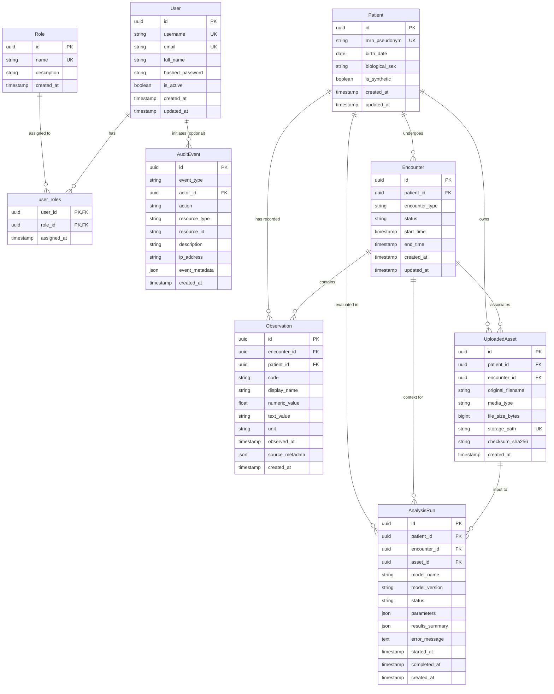

# Arogya AI — Relational Data Models & Entity Architecture

> **Status Notice:** Implemented as of Module 3 (Database Persistence & Data Layer), Phase 3.3.<br/>
> This document defines the initial relational entities, entity-relationship mappings, referential integrity constraints, deletion policies, and governance guardrails for Arogya AI.
>
> **Scope Boundary:**
> * **Active Models:** User, Role, Patient, Encounter, Observation, UploadedAsset, AnalysisRun, and AuditEvent (SQLAlchemy 2.x declarative models in [`backend/app/db/models.py`](../../backend/app/db/models.py)).
> * **Deferred Functionality:** Pydantic API data contracts (Phase 3.4), Alembic migrations/seed scripts (Phase 3.5), data repository/service patterns (Phase 3.6), and authentication/RBAC middleware (Module 7).

---

## 1. Entity Relationship Overview

The core domain model establishes an auditable, research-grade relational schema designed specifically for clinical prototyping without storing protected health information (PHI):



---

## 2. Initial Entities & Purposes

| Entity | Table Name | Primary Responsibility |
| :--- | :--- | :--- |
| **`User`** | `users` | Accounts for clinicians, researchers, and administrators. Plaintext passwords strictly forbidden; stores optional password hashes for future authentication (Module 7). |
| **`Role`** | `roles` | System authorization categories (`administrator`, `clinician`, `researcher`) defining RBAC permission tiers. |
| **`user_roles`** | `user_roles` | Explicit composite association table supporting Many-to-Many assignments between users and roles with assignment timestamping. |
| **`Patient`** | `patients` | Research cohort and synthetic patient records. Uses generated UUIDs and pseudonymous identifiers (`mrn_pseudonym`). Zero PHI policy enforced. |
| **`Encounter`** | `encounters` | Clinical visits, research sessions, or synthetic evaluation epochs associated with a patient. Captures status, type, and temporal boundaries. |
| **`Observation`** | `observations` | Ground-truth measurements (vitals, lab results). Distinctly supports quantitative (`numeric_value`) and qualitative (`text_value`) findings. |
| **`UploadedAsset`** | `uploaded_assets` | Metadata for uploaded clinical images (e.g. chest X-rays) or study documents. **Tracks file references and checksums; binary contents are never stored in the database.** |
| **`AnalysisRun`** | `analysis_runs` | Execution history of multimodal research algorithms (vision classifiers, tabular risk models). **Strictly segregates model outputs from confirmed patient observations.** |
| **`AuditEvent`** | `audit_events` | Immutable system event log for regulatory compliance and operational traceability. Strictly scrubs PHI, session tokens, and passwords from payloads. |

---

## 3. Referential Integrity & Deletion Policies

In clinical and healthcare information systems, cascading deletions risk accidental destruction of vital medical history, patient safety evidence, and audit logs. Arogya AI adopts deliberate referential deletion policies:

```text
┌─────────────────┐       RESTRICT       ┌─────────────────┐
│     Patient     │ ───────────────────> │    Encounter    │ (Cannot delete patient while encounters exist)
└─────────────────┘                      └─────────────────┘
         │ RESTRICT                               │ RESTRICT
         ▼                                        ▼
┌─────────────────┐                      ┌─────────────────┐
│  UploadedAsset  │                      │   Observation   │ (Cannot delete encounter while observations exist)
└─────────────────┘                      └─────────────────┘
         │ SET NULL
         ▼
┌─────────────────┐                      ┌─────────────────┐
│   AnalysisRun   │                      │   AuditEvent    │
└─────────────────┘                      └─────────────────┘
                                                  ▲
                                                  │ SET NULL (Preserves audit history if user deleted)
                                         ┌─────────────────┐
                                         │      User       │
                                         └─────────────────┘
```

### Specific Deletion Rules
1. **Patient Deletion (`ondelete="RESTRICT"`):**
   * Attempting to delete a `Patient` record while active `Encounter`, `Observation`, `UploadedAsset`, or `AnalysisRun` records exist raises a database referential integrity error (`IntegrityError`).
   * Prevents accidental erasure of patient clinical history or research data.
2. **Encounter Deletion (`ondelete="RESTRICT"`):**
   * Attempting to delete an `Encounter` that contains active `Observation` records is strictly rejected (`RESTRICT`).
   * If an empty encounter is deleted, associated `UploadedAsset` and `AnalysisRun` records have their `encounter_id` set to `NULL` (`ondelete="SET NULL"`), preserving the asset and analysis history linked directly to the patient.
3. **Uploaded Asset Deletion (`ondelete="SET NULL"`):**
   * If an asset metadata record is deleted, associated `AnalysisRun.asset_id` references are set to `NULL` (`ondelete="SET NULL"`). This preserves the execution record and historical accuracy of past AI evaluations.
4. **User Deletion (`ondelete="SET NULL"` on Audit Events):**
   * If a user account is removed or deactivated, `AuditEvent.actor_id` is updated to `NULL` (`ondelete="SET NULL"`). The audit log entry itself remains intact and immutable, ensuring full operational traceability.
5. **User-Role Association (`ondelete="CASCADE"`):**
   * Deleting a `User` or a `Role` cascades only to the join row in `user_roles`, removing the association link without affecting the underlying role or user.

---

## 4. Key Architectural & Governance Distinctions

### Uploaded Asset Metadata vs. Binary Storage
* **Relational Storage:** The `uploaded_assets` table stores only descriptive metadata: sanitized display filename, MIME media type, file size in bytes, SHA-256 verification checksum, and an opaque relative `storage_path`.
* **Binary Separation:** Raw binary image payloads (e.g. DICOM, JPEG, PNG) are stored in dedicated local object storage volumes or external secure object storage.
* **Security & Performance:** Storing multi-megabyte binary blobs inside database text or blob columns degrades connection pool throughput, bloats database write-ahead logs (WAL), and complicates transactional backups.

### Clinical Observations vs. AI Analysis Outputs
* **`Observation` (Ground Truth):** Represents confirmed clinical findings, physiological vitals, or laboratory measurements acquired from medical devices or validated synthetic generators. Observations are immutable historical records.
* **`AnalysisRun` (Probabilistic Inference):** Represents non-validated, probabilistic model outputs (e.g. classifier probabilities, bounding boxes, SHAP feature importance vectors, abstention triggers).
* **Strict Segregation:** Model outputs are stored in `analysis_runs.results_summary` and are **never** written into `observations`. AI outputs must never overwrite, pollute, or impersonate validated clinical observations.

### Audit Events & Privacy Preservation
* **System Traceability:** The `audit_events` table captures operational telemetry: actor, action, resource type, resource ID, client IP address, and timestamp.
* **Zero PHI in Audit Payloads:** The `event_metadata` JSON field is strictly restricted to operational tracking keys (e.g. `request_id`, execution duration, changed field names). Raw medical values, patient names, passwords, and authorization tokens must **never** be logged into audit event payloads.

---

## 5. Technical Implementation Details

### Primary Keys & Data Types
* **UUID Primary Keys:** All entities utilize `sqlalchemy.types.Uuid` backed by Python's `uuid.uuid4()`.
  * On PostgreSQL: Maps natively to the 128-bit `UUID` data type for storage and indexing efficiency.
  * On SQLite (Testing): Handled portably without custom dialect extensions.
* **Timezone-Aware Timestamps:** All datetime columns (`created_at`, `updated_at`, `start_time`, `observed_at`, `started_at`, `completed_at`) use `DateTime(timezone=True)` with UTC defaults (`lambda: datetime.now(timezone.utc)`).
* **Portable JSON:** `parameters`, `results_summary`, `source_metadata`, and `event_metadata` use standard `sqlalchemy.JSON` for dialect portability across SQLite and PostgreSQL.

---

## 6. Known Limitations & Deferred Features

1. **No Application Migrations Yet (Phase 3.5):** Physical tables are not created during application startup (`create_app()`). DDL execution and schema migration scripts are deferred to Alembic in Phase 3.5.
2. **No Seed Records (Phase 3.5):** Default roles (`administrator`, `clinician`, `researcher`) and synthetic demo cohorts will be seeded via Alembic revision scripts in Phase 3.5.
3. **No Domain Repositories (Phase 3.6):** Data access logic, query filters, and repository abstractions are deferred to Phase 3.6.
4. **No Authentication or Password Verification (Module 7):** `User.hashed_password` is an architectural placeholder. Password hashing algorithms (Argon2id/bcrypt) and JWT session handling are implemented in Module 7.
5. **No File Upload Endpoints (Module 5):** Multipart upload handling and storage volume verification belong to later modules.
6. **Regulatory Compliance Notice:** The presence of healthcare data structures does **not** constitute HIPAA, GDPR, or CDSCO medical device compliance. Arogya AI is strictly an academic research prototype.
