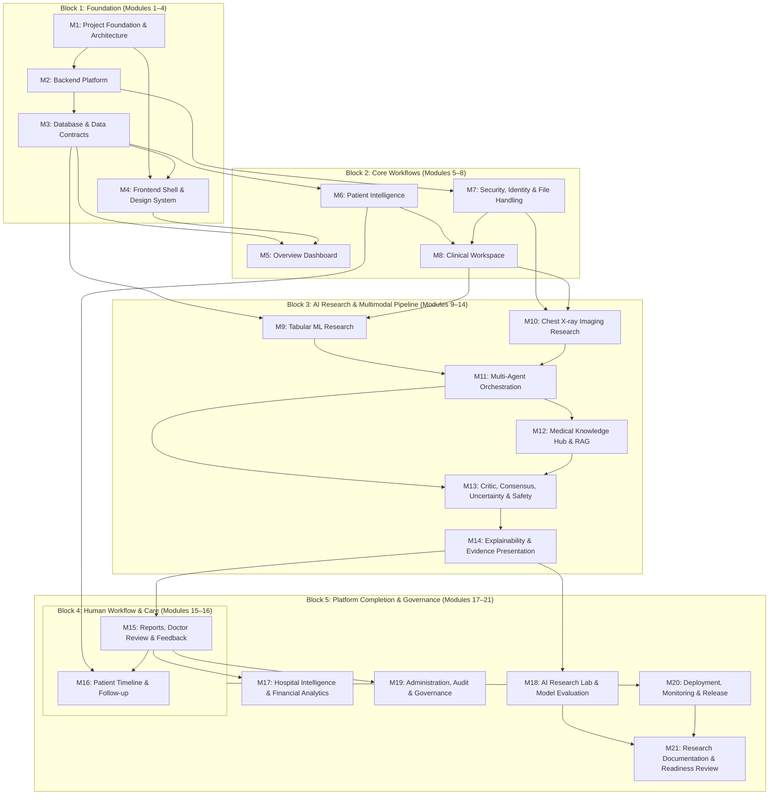

# Arogya AI — Planned Module Dependencies & Execution Order

> **Document Status:** Planning & Architecture Baseline (Module 1). 
> This specification maps the module dependencies, prerequisites, and deliverables across all 21 roadmap modules.

---

## 1. High-Level Dependency Graph

Arogya AI is organized into **five execution blocks**. Work within a block relies on the stability of previous blocks to ensure that machine learning and clinical reasoning are built on tested platforms and contracts.

---

## 2. Canonical Module Matrix (Roadmap v2.0)

| Module | Primary Purpose | Prerequisites | Deliverable / Output Artifact | Safety & Validation Dependency |
| :--- | :--- | :--- | :--- | :--- |
| **Module 1: Project Foundation & Architecture** | Repository structure, standards, documentation, git isolation. | None | Documented monorepo and verified git isolation. | Verification that no secrets or PHI are tracked. |
| **Module 2: Backend Platform** | Core FastAPI service, logging, request IDs, error envelopes. | Module 1 | Runnable FastAPI service with `/api/v1` health tests. | Input sanitization and structured error handling. |
| **Module 3: Database & Data Contracts** | PostgreSQL models, SQLAlchemy schemas, Alembic migrations. | Modules 1–2 | Relational schema and tested data-access layer. | Separation of DB models from API schemas; synthetic seed only. |
| **Module 4: Frontend Shell & Design System** | Next.js UI shell, clinical design tokens, navigation layout. | Module 1 | Reusable UI design system and route shell. | Accessibility (WCAG), honest "not implemented" route states. |
| **Module 5: Overview Dashboard** | System activity, pending-review queues, counters. | Modules 2–4 | Operational dashboard connected to real API. | Clear labeling of synthetic demo data; no fabricated clinical metrics. |
| **Module 6: Patient Intelligence** | Patient records, longitudinal profiles, encounters, vitals. | Modules 2–5 | Working patient and encounter management. | Unit consistency warnings and demographic completeness checks. |
| **Module 7: Security, Identity & File Handling** | RBAC, session auth, audit events, validated image uploads. | Modules 2–3 | Protected API boundaries and validated file handling. | Cross-patient access checks, MIME/magic byte upload validation. |
| **Module 8: Clinical Workspace** | Case creation, unit-aware schemas, analysis run lifecycle. | Modules 3–7 | End-to-end case submission and tracking workflow. | Rejection of unphysiological lab values; explicit analysis run states. |
| **Module 9: Tabular ML Research** | Baseline classification on structured data (vitals/labs). | Modules 3, 8 | Versioned baseline model with reproducible metrics. | Leakage prevention, calibrated probabilities, clear non-diagnostic label. |
| **Module 10: Chest X-ray Imaging Research** | Chest radiography preprocessing, vision model, and Grad-CAM. | Modules 3, 7, 8 | Image inference service and saliency visualization. | Research-only disclaimers; handling of corrupt/non-medical images. |
| **Module 11: Multi-Agent Orchestration** | Deterministic LangGraph state coordination across specialist agents. | Modules 8–10 | Observable multi-agent workflow with stable contracts. | Schema-conforming `AgentResult`; timeouts and failure isolation. |
| **Module 12: Medical Knowledge Hub & RAG** | Vector retrieval of medical guidelines and source attribution. | Modules 2, 3, 8, 11 | Evidence retrieval service and citation panel. | Documents treated as untrusted; resistance to prompt injection. |
| **Module 13: Critic, Consensus, Uncertainty & Safety** | Contradiction detection, disagreement preservation, abstention. | Modules 9–12 | Safety-aware synthesis and abstention triggers. | Low-evidence triggers abstention; preserves clinical contradictions. |
| **Module 14: Explainability & Evidence Presentation** | SHAP attribution and Grad-CAM overlaid with literature evidence. | Modules 9–13 | Explanation panels for supported model outputs. | Distinguish model explanation from biological causation. |
| **Module 15: Reports, Doctor Review & Feedback** | Reviewer interface: accept, modify, reject, audit modifications. | Modules 7–14 | End-to-end human review and export workflow. | Raw AI output preserved separately from clinician edits. |
| **Module 16: Patient Timeline & Follow-up** | Longitudinal encounters, trend charts, staff task workflow. | Modules 3, 6, 7, 15 | Longitudinal patient view and staff task workflow. | Timezone accuracy; tasks designated as staff-only (not patient advice). |
| **Module 17: Hospital Intelligence & Financial Analytics** | Workload stats, bed capacity, inference/storage cost model. | Modules 3–5, 15 | Operational dashboard and financial scenario model. | Separate measured data from simulated/projected estimates. |
| **Module 18: AI Research Lab & Model Evaluation** | Comparative benchmark: multi-agent vs baseline models. | Modules 9–14 | Research dashboard and reproducible comparison report. | Subgroup fairness metrics; documentation of negative results. |
| **Module 19: Administration, Audit & Governance** | User administration, immutable audit query, model registry. | Modules 3, 7, 15 | Administrative console and registry viewer. | Tamper-proof audit logs; role boundaries tested. |
| **Module 20: Deployment, Monitoring & Release** | Docker Compose, CI automated test workflows, release runbooks. | Core modules complete | Repeatable local/demo deployment with CI pipeline. | Clean-install rehearsal; secrets absent from images. |
| **Module 21: Research Documentation & Readiness Review** | Academic handover, model cards, regulatory gap analysis. | All relevant modules | Research handover package and readiness report. | Comprehensive catalog of clinical, privacy, and regulatory gaps. |

---

## 3. Roadmap Alignment & Discrepancy Reconciliation

During Phase 1.4 preflight analysis, the prompt's planning sequence was cross-referenced against the canonical **AROGYA AI Development Roadmap v2.0 (October 2026)**. The differences are reconciled below:

| Canonical Roadmap v2.0 (Governing Standard) | Prompt Planning Sequence | Resolution & Rationale |
| :--- | :--- | :--- |
| **M6: Patient Intelligence** & **M7: Security & File Handling** | M6: Auth & Authorization; M7: Patient Records | **Preserve Canonical v2.0:** Patient intelligence domain schemas are defined before connecting secure file handling and RBAC boundaries, matching the roadmap's modular progression. |
| **M13: Critic, Consensus, Uncertainty & Safety** | M13: Explainability & Uncertainty | **Preserve Canonical v2.0:** Safety, contradiction checking, and abstention logic precede UI presentation of explainability (M14) and human review (M15). |
| **M14: Explainability & Evidence Presentation** | M14: Human Review & Reporting | **Preserve Canonical v2.0:** Explainability panels (SHAP/Grad-CAM) are prerequisites for clinician review and reporting in Module 15. |
| **M15: Reports, Doctor Review & Feedback** | M15: Patient Timeline | **Preserve Canonical v2.0:** Review and reporting feed into the longitudinal timeline (M16) and hospital analytics (M17). |
| **M18: AI Research Lab** & **M19: Administration & Audit** | M18: Administration & Audit; M19: Security Hardening | **Preserve Canonical v2.0:** Research lab benchmarking (M18) directly follows the AI research pipeline, while administration and governance (M19) consolidates platform control. |
| **M20: Deployment, Monitoring & Release** | M20: Testing & Validation; M21: Deployment & Release | **Preserve Canonical v2.0:** Testing is integrated into every phase's acceptance gate; M20 handles packaging and CI, while M21 concludes with research handover and readiness review. |

---

## 4. Parallelization Rules & Safe Concurrency

To ensure stability, parallel development must adhere to the following concurrency boundaries:

* **Permitted Concurrency:**
  * **Module 2 (Backend)** and **Module 4 (Frontend Shell)** can proceed concurrently once Module 1 conventions and contracts are locked.
  * **Module 9 (Tabular ML)** and **Module 10 (Chest X-ray ML)** can proceed concurrently once Module 8 (Workspace intake contracts) is defined.
  * **Module 17 (Hospital Intelligence)** and **Module 18 (AI Research Lab)** can proceed concurrently after human review contracts (Module 15) are settled.
* **Strictly Sequential Gates:**
  * Module 3 (Database) must precede Modules 5, 6, and 8.
  * Modules 9–10 must precede Module 11 (Orchestration).
  * Modules 11–13 must precede Module 15 (Human Review).
