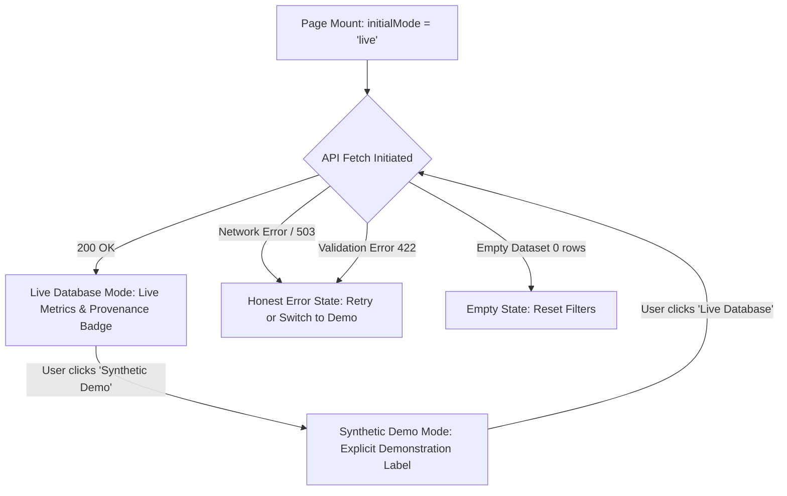

# Arogya AI — Dashboard API Aggregation & Integration

> **Module:** Module 5 (Overview Dashboard)<br/>
> **Phase:** 5.5 (Dashboard API Aggregation & Integration)<br/>
> **Status:** Implementation Complete & Verified<br/>
> **Backend Location:** [`backend/app/repositories/dashboard.py`](file:///C:/_code/Projects/Arogya-AI/backend/app/repositories/dashboard.py), [`backend/app/services/dashboard.py`](file:///C:/_code/Projects/Arogya-AI/backend/app/services/dashboard.py), [`backend/app/api/dashboard.py`](file:///C:/_code/Projects/Arogya-AI/backend/app/api/dashboard.py)<br/>
> **Frontend Location:** [`frontend/services/dashboard.ts`](file:///C:/_code/Projects/Arogya-AI/frontend/services/dashboard.ts), [`frontend/app/page.tsx`](file:///C:/_code/Projects/Arogya-AI/frontend/app/page.tsx)<br/>
> **Documentation Location:** [`docs/dashboard/`](file:///C:/_code/Projects/Arogya-AI/docs/dashboard/)

---

## 1. Objective & Architectural Scope

Phase 5.5 establishes the live database aggregation pipeline and connects the Next.js frontend dashboard to backend services via a versioned, typed REST endpoint:

1. **Database-Backed Aggregations:** Implements `DashboardRepository` using SQLAlchemy 2.0 select and aggregate expressions across `Patient`, `Encounter`, `AnalysisRun`, and `AuditEvent` tables without raw SQL strings.
2. **Service Layer Validation & Orchestration:** Implements `DashboardService` with strict date boundary checks, canonical status filtering, and construction of typed `DashboardOverviewResponse` structures.
3. **Versioned REST API:** Exposes `GET /api/v1/dashboard/overview` through FastAPI with OpenAPI documentation, query parameter validation, standard error response envelopes, and explicit HTTP 503 handling when database connectivity is absent.
4. **Next.js Client Service & Dashboard Integration:** Implements `frontend/services/dashboard.ts` with `AbortController` timeout support, typed error differentiation (`isUnavailable`, `isValidationError`), and connects the root page (`/`) to the live API.
5. **Truthful Data Provenance & Honest States:** Replaces demo metrics with live database results when the API succeeds; preserves an explicitly labeled synthetic demonstration mode; provides honest empty, error, and database-unavailable states without fabricating values or silently suppressing failures.

---

## 2. API Endpoint Specification

### `GET /api/v1/dashboard/overview`

Aggregates operational counts, pipeline lifecycle distributions, review candidate queues, and recent audit activity.

#### Query Parameters

| Parameter | Type | Validation / Constraints | Description |
| :--- | :--- | :--- | :--- |
| `start_date` | `string` (Optional) | ISO-8601 Date or DateTime (e.g. `2026-01-01`). Must be `<= end_date`. | Filters analysis runs and audit logs on or after this timestamp. |
| `end_date` | `string` (Optional) | ISO-8601 Date or DateTime (e.g. `2026-01-31`). Must be `>= start_date`. | Filters analysis runs and audit logs on or before this timestamp. |
| `status` | `string` (Optional) | Canonical status: `queued`, `running`, `completed`, `failed`, `abstained`. | Filters analysis runs and review candidate queue by execution status. |

#### HTTP Response Status Codes

| Status Code | Reason | Response Schema | Description |
| :--- | :--- | :--- | :--- |
| **`200 OK`** | Success | Standard Envelope containing `DashboardOverviewResponse` | Aggregated dashboard overview metrics. |
| **`422 Unprocessable Entity`** | Validation Error | Standard Error Envelope (`VALIDATION_ERROR`) | Invalid date formatting, reversed date range (`start_date > end_date`), or unapproved status string. |
| **`500 Internal Server Error`** | Server Error | Standard Error Envelope (`INTERNAL_SERVER_ERROR`) | Unexpected unhandled server exception. |
| **`503 Service Unavailable`** | Database Unavailable | Standard Error Envelope (`SERVICE_UNAVAILABLE`) | Database connection failed or database driver unconfigured. |

#### Success Response Structure (`200 OK`)

```json
{
  "data": {
    "generated_at": "2026-10-27T00:00:00Z",
    "filter_start_date": "2026-01-01T00:00:00Z",
    "filter_end_date": "2026-01-31T23:59:59.999000Z",
    "filter_status": "completed",
    "patient_summary": {
      "total_patients": 10,
      "synthetic_cohort_count": 10,
      "research_cohort_count": 0,
      "active_patients": 10
    },
    "encounter_summary": {
      "total_encounters": 15,
      "by_status": { "in_progress": 2, "completed": 13 },
      "reporting_period_start": "2026-01-01T00:00:00Z",
      "reporting_period_end": "2026-01-31T23:59:59Z"
    },
    "analysis_summary": {
      "total_runs": 8,
      "by_status": { "completed": 5, "running": 1, "failed": 1, "abstained": 1, "queued": 0 },
      "models_active": 3,
      "latest_run_at": "2026-01-31T20:00:00Z"
    },
    "pending_review_queue": {
      "pending_count": 4,
      "requires_urgent_review_count": 0,
      "items": [
        {
          "analysis_run_id": "00000000-0000-0000-0000-000000000001",
          "encounter_id": "00000000-0000-0000-0000-000000000002",
          "patient_mrn": "SYNTH-PAT-0001",
          "model_name": "clinical_risk_v1",
          "model_version": "1.0.0",
          "status": "completed",
          "created_at": "2026-01-20T10:00:00Z"
        }
      ]
    },
    "recent_activity": {
      "total_events": 20,
      "events": [
        {
          "event_id": "00000000-0000-0000-0000-000000000003",
          "event_type": "analysis.completed",
          "action": "execute",
          "resource_type": "analysis_run",
          "resource_id": "00000000-0000-0000-0000-000000000001",
          "actor_id": "system_worker",
          "actor_type": "service",
          "timestamp": "2026-01-20T10:00:00Z",
          "status": "success"
        }
      ]
    }
  },
  "error": null
}
```

---

## 3. Database Aggregation Architecture (`DashboardRepository`)

The [`DashboardRepository`](file:///C:/_code/Projects/Arogya-AI/backend/app/repositories/dashboard.py) coordinates SQL aggregation across normalized clinical and operational entities.

### Key Aggregation Queries

1. **Patient Cohort Segmentation:**
   - Evaluates total patients, active status (`is_active = true`), and partitions cohorts by pseudonym prefix:
   - `synthetic_cohort_count`: `func.count().filter(Patient.mrn_pseudonym.like('SYNTH-%'))`
   - `research_cohort_count`: `func.count().filter(not_(Patient.mrn_pseudonym.like('SYNTH-%')))`

2. **Encounter Statuses & Observation Windows:**
   - Evaluates `total_encounters`, group counts by `Encounter.status`, and calculates the enclosing clinical timeline via `func.min(Encounter.start_time)` and `func.max(Encounter.end_time)`.

3. **Analysis Lifecycle Distribution:**
   - Aggregates counts grouped by `AnalysisRun.status`.
   - Distinct model architectures via `select(AnalysisRun.model_name).distinct()`.
   - Supports optional filtering by status and date boundaries (`created_at >= start_date`, `created_at <= end_date`).

4. **Review Candidate Queue Identification:**
   - **Candidate Selection Rule:** Completed or abstained runs (`AnalysisRun.status.in_(["completed", "abstained"])`) that have **not** undergone clinical review.
   - **Audit Exclusion Subquery:** An analysis run is excluded if an audit log exists with `action = "review"` or `event_type.like("%review%")`.
   - **Cross-Database Compatibility:** Both SQLite and PostgreSQL differ in string formatting of UUID primary keys in subqueries. The exclusion subquery uses `func.replace(cast(AnalysisRun.id, String), "-", "").not_in(...)` and `func.replace(AuditEvent.resource_id, "-", "")` to ensure zero-defect behavior across both engines.

5. **Operational Audit Activity:**
   - Fetches the most recent system audit events ordered by `timestamp.desc()` with optional date boundaries.

---

## 4. Frontend Integration (`frontend/services/dashboard.ts` & `frontend/app/page.tsx`)

### Frontend Service Client (`frontend/services/dashboard.ts`)

- **`fetchDashboardOverview(filters, options)`:** Fetches live metrics from `${API_BASE_URL}/api/v1/dashboard/overview`.
- **Configurable Base URL:** Resolves from `NEXT_PUBLIC_API_URL` or defaults to `http://localhost:8000`.
- **Timeout & Cancellation:** Built-in `AbortController` support with default 10,000ms timeout.
- **Typed Error Envelope:** Custom `DashboardApiError` class distinguishing network timeouts, 422 validation errors, and 503 database unavailability.

### Overview Dashboard Lifecycle & Presentation States

The root page (`frontend/app/page.tsx`) implements responsive view modes and honest fallback mechanisms:



- **Live Presentation:** Replaces synthetic numbers with live database counts upon successful API fetch.
- **View Mode Switcher:** Provides explicit toggles for `"Live Database"`, `"Synthetic Demo"`, `"Integration Pending"`, and `"Loading Skeleton"`.
- **Honest Fallback:** If the backend or PostgreSQL database is unavailable, the user is presented with a clear `ErrorState` banner with options to *"Retry Live Request"* or *"Switch to Synthetic Demo"*. Synthetic demonstration data is **never** presented as live database results.
- **Filter Synchronization:** Changing the Date Range or Status filter on the page triggers a live API query with the updated query parameters.

---

## 5. Verification & Test Coverage Matrix

### Backend Tests (`187 passed`)

| Test File | Tests | Focus Areas |
| :--- | :--- | :--- |
| [`test_dashboard_repository.py`](file:///C:/_code/Projects/Arogya-AI/backend/tests/test_dashboard_repository.py) | 8 | Empty database aggregations, patient cohort segmentation, encounter status grouping, analysis status distribution, review candidate queue exclusion of reviewed runs, audit activity feed, and date boundary filtering. |
| [`test_dashboard_service.py`](file:///C:/_code/Projects/Arogya-AI/backend/tests/test_dashboard_service.py) | 4 | Overview generation, canonical status validation, reversed date boundary validation (`start_date > end_date`), and contract adherence. |
| [`test_dashboard_api.py`](file:///C:/_code/Projects/Arogya-AI/backend/tests/test_dashboard_api.py) | 7 | Endpoint `GET /api/v1/dashboard/overview` 200 response, query parameters (`status`, `start_date`, `end_date`), 422 on reversed dates, 422 on invalid status, and 503 handling when database is unavailable. |

### Frontend Tests (`124 passed`)

| Test File | Tests | Focus Areas |
| :--- | :--- | :--- |
| [`dashboard.test.tsx`](file:///C:/_code/Projects/Arogya-AI/frontend/tests/dashboard.test.tsx) | 26 | Dashboard API client URL construction, parameter serialization, successful response parsing, 503 database unavailable handling, 422 validation handling, timeout abortion, component rendering, filter propagation, and live vs demo presentation modes. |

---

## 6. Safety Boundaries & Ethical Constraints Preserved

1. **Zero PHI Exposure:** Only aggregated cohort counts, pseudonymized identifiers (`SYNTH-PAT-0001`), and pipeline operational metrics are transmitted over the API.
2. **Review Workflow Truthfulness:** Review candidate analysis runs are explicitly identified as candidates awaiting oversight. No formal doctor sign-off workflow is fabricated.
3. **Diagnostic Integrity:** No clinical diagnostic confidence, ROC curves, or medical efficacy claims are displayed on the Overview Dashboard.
4. **Repository Isolation:** All changes and configurations are strictly isolated to `C:\_code\Projects\Arogya-AI`. The parent repository is entirely untouched.
